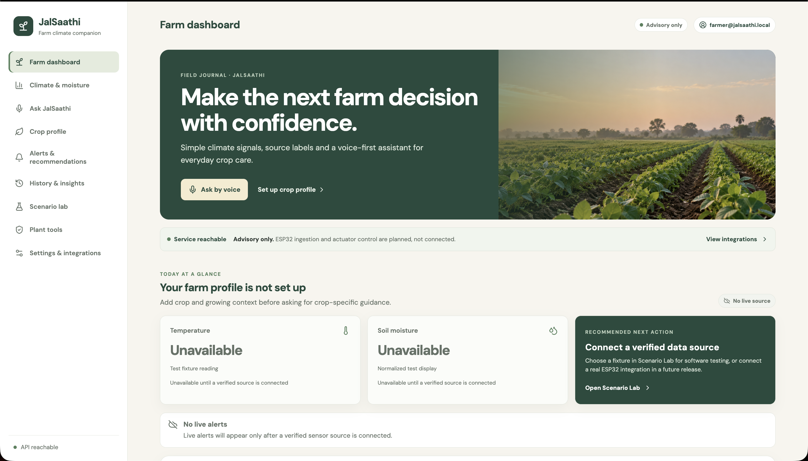
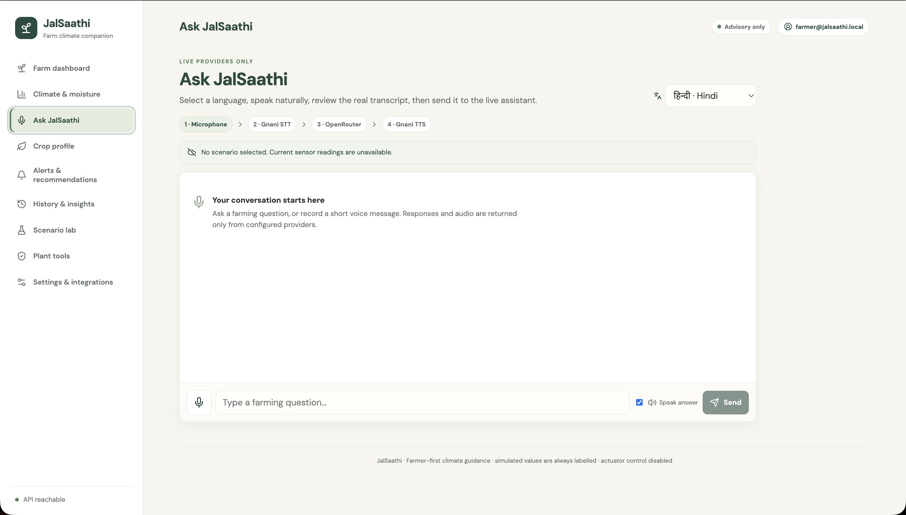

# 🌾 Smart Agriculture Assistant (JalSaathi)

[](https://fastapi.tiangolo.com)
[](https://react.dev)
[](https://vitejs.dev)
[](https://catboost.ai)
[-FF6F00.svg?style=flat&logo=TensorFlow&logoColor=white)](https://tensorflow.org)
[](https://huggingface.co/DhruvKatharotiya/smart-agriculture-models)
[](LICENSE)

A voice-first, climate-aware, AI-powered agricultural advisory platform designed for small- and medium-scale farmers. **JalSaathi** delivers precision crop recommendations, deep-learning plant disease diagnosis, greenhouse IoT telemetry, and multilingual voice conversational guidance in regional Indian languages.

---

## 📸 Screenshots

| Farmer Dashboard & IoT Monitor | AI Leaf Disease Diagnosis |
| :---: | :---: |
|  |  |

---

## 🌟 Key Features

### 1. 🧪 Smart Crop Recommendation
- **Algorithm:** Gradient boosted decision trees ([CatBoost](https://catboost.ai)) evaluated against Random Forest & XGBoost.
- **Inputs:** Soil macronutrients (Nitrogen $N$, Phosphorus $P$, Potassium $K$), pH, and agro-climatic values (Temperature, Relative Humidity, Rainfall).
- **Output:** Optimal crop choice with confidence scoring across 22 major crop varieties.

### 2. 🔬 Deep Learning Leaf Disease Detection
- **Architecture:** Transfer-learned **ResNet-50** models fine-tuned per crop with custom classification heads.
- **Coverage:** **13 Agricultural Crops** — Apple, Black Gram, Coconut, Coffee, Grapes, Jute, Maize, Mango, Orange, Pigeon Pea, Rice, Watermelon, and Wild Plant varieties.
- **Model Storage:** Weights automatically stream on-demand from [Hugging Face Hub (`DhruvKatharotiya/smart-agriculture-models`)](https://huggingface.co/DhruvKatharotiya/smart-agriculture-models) and cache locally.
- **Safety Thresholds:** Confidence filtering (<60% flags as uncertain), top-3 candidate differential diagnoses, and tailored **organic**, **chemical**, and **preventive** actionable remedies.

### 3. 🎙️ JalSaathi Voice & Multilingual Assistant
- **LLM Reasoning:** OpenRouter AI models (`nvidia/nemotron-3.5-lightning:free` / Gemini) grounded with active crop and climate context.
- **Speech-to-Text (STT):** High-accuracy Indic voice recognition powered by [Gnani Vachana AI](https://gnani.ai).
- **Text-to-Speech (TTS):** Natural speech synthesis in regional languages.
- **Supported Locales:** Hindi (`hi-IN`), Punjabi (`pa-IN`), Bengali (`bn-IN`), Marathi (`mr-IN`), and Indian English (`en-IN`).

### 4. 🌡️ Polyhouse Greenhouse IoT Monitor
- **Real-Time Telemetry:** Live temperature, humidity, and soil moisture sensor monitoring.
- **Hardware Integration:** Compatible with ESP8266 & ESP32 sensor nodes with local proxy to bypass browser mixed-content/CORS limitations.
- **Simulation Lab:** Built-in 20 deterministic climate stress scenarios (heatwave, frost, drought, saturated soil, boundary states) for offline demonstration and testing.

### 5. 🔐 Authentication & Offline Demo Mode
- **Production Auth:** Supabase Auth with secure JWT bearer token validation.
- **Zero-Config Demo Mode:** Enable instant testing without cloud credentials using `JALSAATHI_LOCAL_DEMO_AUTH=true`.

---

## 🏗️ Architecture & Technology Stack

```
smart-agriculture-assistant/
├── app.py                      # Unified local runner (boots both backend & frontend)
├── backend/                    # FastAPI REST API Backend
│   ├── main.py                 # API routes, CORS & middleware
│   ├── crop.py                 # CatBoost crop recommendation service
│   ├── disease.py              # ResNet50 disease diagnosis & HuggingFace downloader
│   ├── chatbot.py              # Farming assistant dialogue & OpenRouter integration
│   ├── auth.py                 # Supabase JWT authentication & demo fallback
│   ├── jalsaathi_domain.py     # Climate scenarios & deterministic rule engine
│   ├── jalsaathi_providers.py  # LLM, STT, and TTS third-party integrations
│   ├── models/                 # Pretrained weights (.pkl) & disease cache (.keras)
│   ├── test_api_local.py       # Comprehensive backend endpoint verification suite
│   └── test_jalsaathi.py       # Domain logic unit tests
├── frontend/                   # Modern React 18 + Vite SPA
│   ├── src/
│   │   ├── App.jsx             # Tab orchestration & core state
│   │   ├── api.js              # Centralized backend HTTP client
│   │   ├── auth.js             # Supabase & demo auth provider
│   │   └── components/         # Modular UI (ChatTab, CropTab, DiseaseTab, IoT, etc.)
├── ml/                         # Data science & model training
│   ├── notebooks/              # Jupyter notebooks for EDA and model evaluation
│   ├── prediction/             # Standalone inference scripts
│   └── reports/                # Confusion matrices & evaluation CSVs
├── render.yaml                 # Render Blueprint deployment definition
└── vercel.json                 # Vercel SPA routing configuration
```

---

## 🚀 Quickstart: Running Locally

### Prerequisites
- **Python:** 3.10, 3.11, or 3.13
- **Node.js:** 18+ and `npm`

### 1. Clone & Configure Environment

```bash
git clone https://github.com/pj2411/smart-agriculture-assistant.git
cd smart-agriculture-assistant

# Copy example environment files
cp .env.example .env
cp frontend/.env.example frontend/.env
```

Edit `.env` with your API credentials (or keep demo mode enabled):
```env
# Enable instant demo mode without external accounts
JALSAATHI_LOCAL_DEMO_AUTH=true

# Optional AI credentials
OPENROUTER_API_KEY=your_key_here
GNANI_STT_API_KEY_ID=your_key_here
GNANI_TTS_API_KEY=your_key_here
```

### 2. Install Dependencies

**Backend:**
```bash
python3 -m venv .venv
source .venv/bin/activate       # On Windows: .venv\Scripts\activate
pip install -r requirements.txt
```

**Frontend:**
```bash
cd frontend
npm install
cd ..
```

### 3. One-Command Launch (Recommended)

Run the unified orchestrator from the project root:
```bash
python app.py
```
This automatically starts:
- 🚀 **FastAPI Backend:** [http://127.0.0.1:8000](http://127.0.0.1:8000)
- 📚 **Interactive Swagger Docs:** [http://127.0.0.1:8000/docs](http://127.0.0.1:8000/docs)
- 🌐 **Vite Frontend:** [http://127.0.0.1:5173](http://127.0.0.1:5173)

---

### Manual Launch (Separate Terminals)

If you prefer running services independently:

**Terminal 1 — Backend:**
```bash
cd backend
source ../.venv/bin/activate
uvicorn main:app --host 127.0.0.1 --port 8000 --reload
```

**Terminal 2 — Frontend:**
```bash
cd frontend
npm run dev
```

---

## 🧪 Verification & Testing

Run the included automated test suites to verify system integrity:

```bash
# 1. Run climate domain logic unit tests (4 tests)
python backend/test_jalsaathi.py

# 2. Run backend API verification suite (Health, Crop, Disease, Chat)
python backend/test_api_local.py

# 3. Test leaf disease prediction on sample leaves
python verify_sample_leaves.py
```

---

## 🌐 API Overview

| Method | Endpoint | Description |
| :--- | :--- | :--- |
| `GET` | `/health` | Core system health, provider statuses & scenario counts |
| `POST` | `/api/crop/predict` | Crop recommendation from $N, P, K, \text{pH}, \text{rainfall}, \text{temp}, \text{humidity}$ |
| `GET` | `/api/disease/crops` | List all 13 supported crops for leaf diagnosis |
| `POST` | `/api/disease/predict` | Multipart leaf image upload + crop diagnosis |
| `POST` | `/api/chat` | Multilingual agricultural advisory chat (OpenRouter LLM) |
| `POST` | `/api/voice/transcribe` | Multipart audio file transcription via Gnani STT |
| `POST` | `/api/voice/speak` | Text-to-speech audio synthesis via Gnani TTS |
| `GET` | `/api/scenarios` | 20 test-only climate simulation fixtures |
| `GET` | `/api/iot/polyhouse/data` | ESP8266/ESP32 sensor telemetry bridge |

---

## 🚢 Deployment Guide

### Backend: Render
The project includes a ready-to-use [`render.yaml`](render.yaml) blueprint:
1. Connect your repository to [Render](https://render.com).
2. Create a new **Blueprint** service selecting `render.yaml`.
3. Provide environment variables (`OPENROUTER_API_KEY`, `GNANI_STT_API_KEY_ID`, `GNANI_TTS_API_KEY`, etc.).
4. The service will build via `pip install -r requirements.txt` and serve with Gunicorn + Uvicorn worker.

### Frontend: Vercel
Configured via [`vercel.json`](vercel.json) with automated SPA asset rewrites:
1. Import repository into [Vercel](https://vercel.com).
2. Set Root Directory to `./` or `frontend`.
3. Set Build Command to `npm --prefix frontend run build` (or `npm run build` if root is `frontend`).
4. Set Output Directory to `frontend/dist` (or `dist`).
5. Configure `VITE_API_URL` to point to your live Render backend URL.

---

## 📄 License
This project is licensed under the [MIT License](LICENSE).
